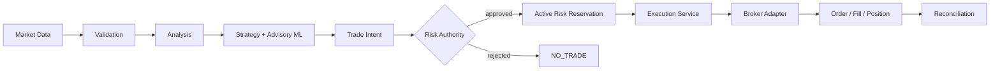

# Risk-First Algorithmic Trading Platform

> **Showcase repository.** The source code is private. This page describes the architecture, design decisions and engineering approach. A live code walkthrough is available on request — see [Contact](#contact).

An automated trading platform built in Python around one non-negotiable principle:

**Capital preservation first, profit generation second.**

Whenever market data, broker state, application state, model confidence or risk state is uncertain, the system's answer is `NO_TRADE`.

---

## At a glance

| | |
|---|---|
| **Language** | Python |
| **API** | FastAPI |
| **Data** | PostgreSQL (SQLAlchemy, Alembic migrations), Redis |
| **ML** | Logistic regression, gradient-boosted trees (advisory only) |
| **Broker** | OANDA (read-first integration) |
| **Infrastructure** | Docker, Prometheus-compatible metrics, structured JSON logging |
| **Testing** | pytest unit and integration suites, architecture-boundary tests |
| **Security** | JWT + MFA authentication, RBAC, hash-chained audit log |
| **Status** | Phase 13 of 13 in development · paper trading |

---

## The trading flow

Every trade, without exception, follows this path. No component can skip a step.

- The AI does not place orders.
- The analysis engine does not place orders.
- The API cannot bypass risk validation.
- Only the execution service talks to the broker, and only after confirming a valid, unexpired, risk-approved authorisation.

These boundaries are **enforced by automated tests that inspect the code's structure**, not just documented.

---

## Key components

### Risk Authority
The final, non-bypassable gate for every trade. It handles instrument-aware position sizing, portfolio-level risk limits, currency conversion, news blackout periods, a durable emergency stop, and expiring risk reservations serialised per account so that two trades can never claim the same risk budget.

### Deterministic backtesting
A historical replay engine with a structural guarantee against look-ahead bias: at any simulated moment, future data is simply not reachable. Crucially, backtests **reuse the production analysis, strategy, risk and execution code unmodified**, so what is tested is what runs. Backtest data is stored in isolated tables with no links to live trading data.

### Strategy research
Declared walk-forward experiments with strict out-of-sample and final-holdout separation, plus cost-stress and parameter-sensitivity scenarios and performance attribution by market regime, symbol and timeframe. Strategy promotion goes through eleven independent qualification gates evaluated on frozen evidence, and is always an explicit human decision — never automatic.

### Advisory ML layer
Interpretable models trained on leakage-safe feature datasets using strict temporal train / validation / holdout splits.

- **Can narrow, never widen.** A model can veto a trade the deterministic strategy proposed. It can never create a trade, choose a direction, size a position or bypass the Risk Authority.
- **Abstains instead of guessing.** Out-of-distribution inputs or any uncertainty result in abstention rather than invented confidence.
- **Immutable model registry.** Every model is versioned, hash-verified on load and schema-checked. Promotion is explicit, never automatic.

### Continuous paper trading
An orchestrator that runs the full pipeline continuously in paper mode:

- **One session per account**, enforced by a database-backed lease.
- **Idempotent processing.** Each market bar is processed exactly once; a duplicate poll can never trigger a duplicate trade.
- **Restart-first recovery.** After any restart, trading cannot resume until reconciliation proves local state matches the broker's.

### Controlled live-trading safeguards
Real-money execution is locked behind multiple independent controls: a staged, two-step-confirmed activation level (with deliberately no "full autonomy" level), a single-use authorisation for each specific trade, and a final guard re-check immediately before any broker call. An ambiguous broker response is never retried — it freezes the account until reconciliation resolves it.

---

## Engineering approach

- **Fail closed.** Missing data, provider failures and uncertainty all lead to `NO_TRADE`, never to silent degradation.
- **Built in phases.** Thirteen incremental phases, each adding one capability on top of a tested foundation without rewriting earlier layers.
- **Decisions are documented.** Every significant design choice is recorded as an Architecture Decision Record (40+ ADRs).
- **Operability.** Production startup safety checks, a non-root health-checked container image, a migration advisory lock, a metrics endpoint, a read-mostly operator CLI, and runbooks for deployment, disaster recovery and incident response.

---

## Screenshots

<!-- Add 2–4 screenshots here, e.g. a backtest report, walk-forward results, the runtime session status or the operator CLI. -->

---

## Contact

The source code is private. I'm happy to give a live walkthrough of the codebase, tests and design decisions.

**Sifiso Zikhali** · [sfisoseanzikhali@gmail.com](mailto:sfisoseanzikhali@gmail.com) · [LinkedIn](https://linkedin.com/in/sifiso-zikhali-5b1660230)

*This project is for engineering and research purposes. Nothing here is financial advice.*
